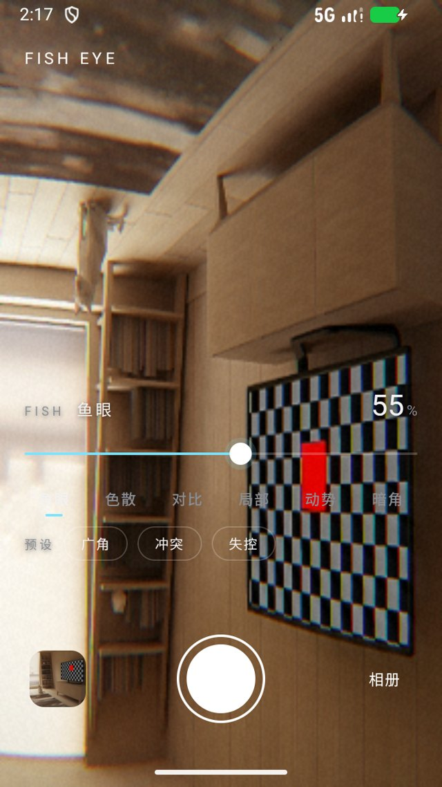
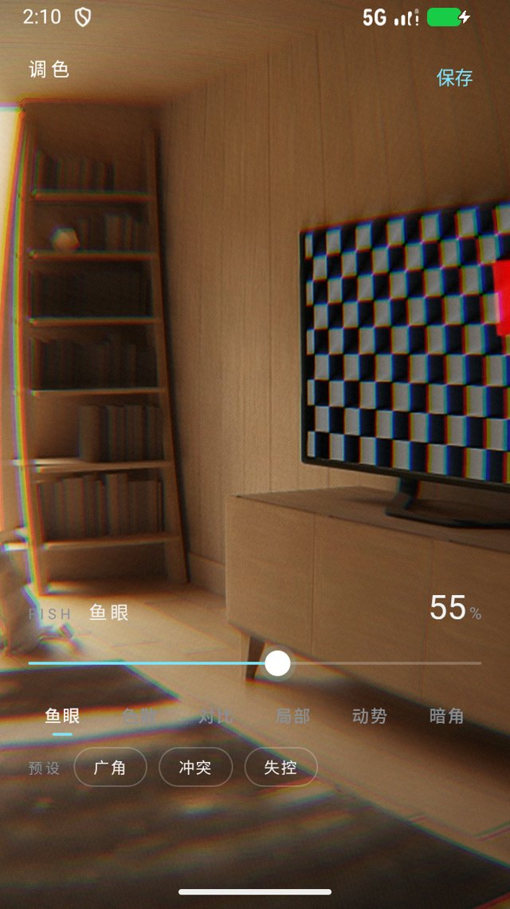
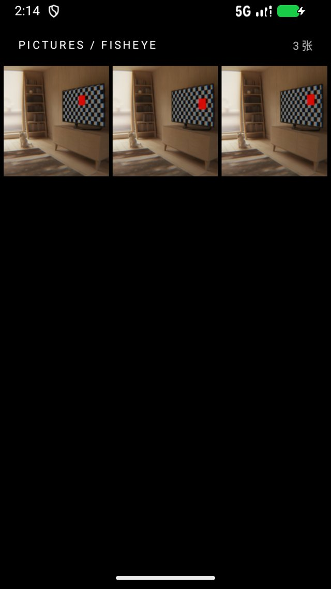

# FishEye

给 Android 的极简「张力」相机：**取景时就把画面推成鱼眼、加色散、压影调**，按下快门存下来的就是眼前看到的样子。

A minimal Android camera that renders a tension pipeline live in the viewfinder.

<p align="center">
  
  
  
</p>

## 它解决哪件事

鱼眼、色散、径向模糊这些东西，传统上都是拍完再进修图软件拧。问题是——**你没法一边拧一边看**：画面一变，你就不确定该往哪儿站、往哪儿压。

FishEye 把整条管线搬到取景时。面板上六个滑块拖到哪，取景就变成什么样；按快门时，同一张照片用**同一套 GLSL** 在离屏再渲染一遍存盘。预览什么样，存下来就是什么样。

## 怎么用

| 动作 | 结果 |
| --- | --- |
| 拖底部滑块 | 实时改当前那一项；六个页签切换要调的项（鱼眼 / 色散 / 对比 / 局部 / 动势 / 暗角） |
| 点 `广角` `冲突` `失控` | 三套预设，越往后越「失控」 |
| 点取景任意处 | 那里对焦测光，**同时把径向模糊的中心挪过去**（对焦框亮一下） |
| 按快门 | 渲染后存进 `Pictures/FishEye`，留在取景继续拍（参数不复位） |
| 点左下缩略图 | 进调色页继续微调刚拍的这张 |
| 点 `相册` | 三列网格；单击进调色，长按删除 |
| 调色页 `保存` | 另存为新照片 / 覆盖原图 |

取景亮度会让界面文字自动反色：底部暗配浅字、底部亮配深字，不在画面上盖任何色块。

## 它怎么做到的

取景不是 `PreviewView` 直出，而是自己接管相机：

```
CameraX Preview ──SurfaceTexture(外部纹理)──> GL 线程
                                              │
                        pass 1  鱼眼变形 → 色散 → 曝光 → 局部对比 → S 曲线 → 饱和
                                              │
                        pass 2  径向缩放模糊 → 暗角 → 颗粒
                                              │
                                   eglSwapBuffers → SurfaceView
```

- **预览零 CPU 回读**：全程在显存里过。唯一的回读是每 500ms 取一张 16×16 缩图，只看屏幕下三分之一（控件文字压着的那一带）算亮度，用来反色。
- **成片走同一条管线**：快门后把 JPEG 解成 Bitmap，交给**同一个** `GlPreviewView` 在离屏 FBO 上跑同样的两趟 shader，再 `glReadPixels` 回 Bitmap 存盘。两边的 GLSL 是同一份字符串。
- **方向在 CPU 侧摆正**：EXIF 角度先用 `Matrix` 转到位，GL 只做纯 2D 采样。否则「竖翻 + 旋转」会复合成反射，拍出来左右镜像（这个坑实测踩过）。
- **参数平滑**：滑块值不直接进 shader，每帧向目标靠 22%，拖过去是「滑」过去的，模糊中心与色散都不跳帧。
- **鱼眼连续可退化**：`r_src = tan(r·k)/tan(rmax·k)·rmax`，k→0 时退化成线性直出，所以强度从 0 拖到 100 没有跳变点。
- **失败要说出来**：EGL 配置/上下文/窗口表面建不起来、着色器编译失败、8 秒没有一帧，都会在屏幕上弹一条原因，而不是留一片黑。
- **慢设备自动降级**：连续 8 帧平均超过 70ms 就把预览缓冲区缩到 0.55×（最多三次），合成器负责放大，画面比例不变；成片不受影响。

## 构建

需要 JDK 17+ 和 Android SDK（`compileSdk 37`）。

```bash
git clone <repo>
cd FishEye
sh ./gradlew assembleDebug        # Windows 的 git-bash；cmd 下用 gradlew.bat
```

产物在 `app/build/outputs/apk/debug/app-debug.apk`。

> 本机在墙内，`gradle.properties` 里带了 Clash（127.0.0.1:7897）的代理设置；换机器或关代理时删掉那四行 `systemProp.*`。

## 实测结论

在 `Small_Phone`（x86_64，720×1280，API 37，SwiftShader 软件渲染）上验过：

- 取景实时出画，鱼眼 / 色散 / 暗角 / 颗粒全部生效；软件渲染下约 2–3 fps，自适应降级后明显变顺。
- 快门 → `Pictures/FishEye` 出 960×1280 JPEG，方向正确、不镜像，取景里看到的调色与成片一致。
- 相册能列出、能进调色页；调色页另存会在相册里多出一张。
- 取景反色：底部亮度越阈值时界面文字切深色，回落时切回浅色。

真机（有真 GPU 的机器）未验。

## 权限

| 权限 | 用途 |
| --- | --- |
| `CAMERA` | 取景与拍照 |
| `READ_MEDIA_IMAGES`（Android 13+）<br>`READ_EXTERNAL_STORAGE`（Android 12 及以下） | 相册列表与缩略图 |
| `WRITE_EXTERNAL_STORAGE`（Android 9 及以下） | 老系统写入 `Pictures/FishEye` |

## 它做不到的

- 只有后摄；没有前摄、闪光灯、变焦——刻意做窄。
- 照片只进 `Pictures/FishEye`。
- 成片先解码再重新编码，所以是「一次 JPEG 往返」；要无损得改成 GL 直出捕获。

## 代码结构

| 文件 | 职责 |
| --- | --- |
| `CameraActivity` | 取景、实时管线、快门、缩略图、明暗自适应主题 |
| `GlPreviewView` | 自己的取景器：EGL + SurfaceTexture + 两趟 shader + 离屏烘焙 + 慢设备降级 |
| `Shaders` | 全部 GLSL（预览与成片共用同一份） |
| `Params` | 参数、UI 百分比换算、三套预设、逐帧平滑 |
| `EditorActivity` | 调色页：读图、走同一条管线、另存/覆盖 |
| `GalleryActivity` | 相册：`Pictures/FishEye` 三列网格、长按删除 |
| `AlbumStore` | MediaStore 的唯一出入口 |
| `assets/controls.html` `controls.css` | 滑块面板，拍摄页与调色页共用一套 |

## 许可

[MIT](LICENSE)
