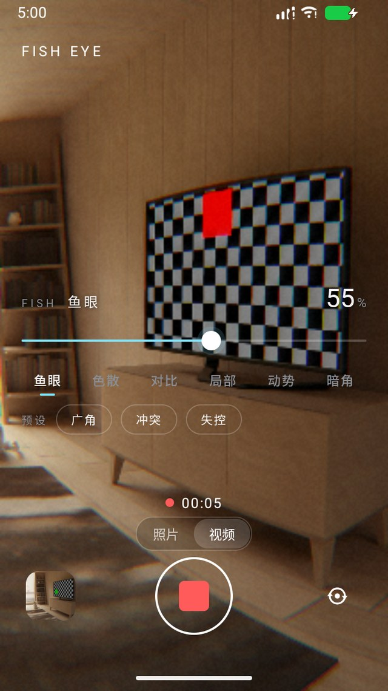
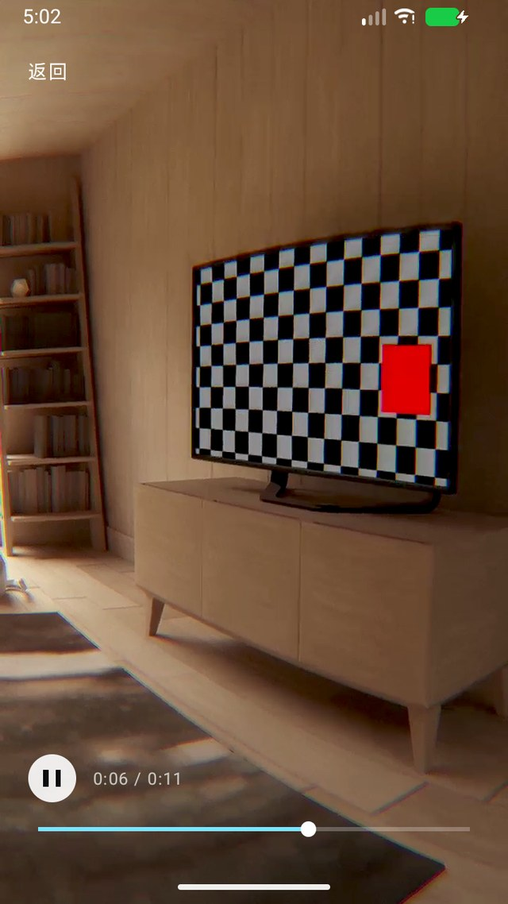

# FishEye

给 Android 的极简「张力」相机：**取景时就把画面推成鱼眼、加色散、压影调**，按下快门存下来的就是眼前看到的样子。录像同理，只是把同一套着色器接到了编码器上。

A minimal Android camera that renders a tension pipeline live in the viewfinder.

<p align="center">
  
  
  
  
</p>

## 它解决哪件事

鱼眼、色散、径向模糊传统上都是拍完再修。问题是**你没法一边拧一边看**：画面一变，你就不确定该往哪儿站、该把什么推进画面。

FishEye 把整条管线搬到取景时。六个滑块拖到哪，取景就是什么样；快门按下时，同一张照片用**同一份 GLSL** 在离屏再渲一遍再存盘。录像也一样——处理器直接插在相机与编码器之间，录下来的帧和取景框里是同一条管线。参数不会因为拍完而复位，可以边拍边调。

## 怎么用

| 动作 | 结果 |
| --- | --- |
| 拖底部滑块 | 实时改当前那一项；六个页签切换（鱼眼 / 色散 / 对比 / 局部 / 动势 / 暗角） |
| 点 `广角` `冲突` `失控` | 三套预设，越往后越「失控」 |
| 点取景任意处 | 那里对焦测光，**径向模糊的中心跟着挪过去** |
| 点 `照片 / 视频` | 换拍摄模式；视频模式取景切到 16:9，和录出来的画面一致 |
| 点快门（照片） | 渲染后存进 `Pictures/FishEye`，留在取景继续拍 |
| 点快门（视频） | 开始录像，快门变红方块、右上角计时；再点结束，存进 `Movies/FishEye` |
| 点左下缩略图 | 进相册（从缩略图位置放大进入） |
| 相册单击 / 长按 | 看照片、放录像 / 进选择模式，按住涂抹＝按序列连选，右上「删除」 |
| 右下图标 | 前后摄切换 |

界面不用系统弹窗和 Toast，提示条、确认框、播放控件都是自绘的；取景亮度变了，文字会自动反色。

## 管线

```
相机 ──SurfaceTexture（外部纹理）──> GL 线程
                                    pass 1  鱼眼 → 色散 → 曝光 → 局部对比 → S 曲线 → 饱和
                                    pass 2  径向缩放模糊 → 暗角 → 颗粒
                                      ├─ 取景：eglSwapBuffers → SurfaceView
                                      ├─ 照片：离屏 FBO → glReadPixels → JPEG
                                      └─ 录像：SurfaceProcessor → 编码器输入 Surface
```

- 取景零 CPU 回读：全程在显存里过。唯一的回读是每 500ms 一张 16×16 缩图，只看控件文字压着的那一带，用来决定界面明暗。
- 三条通路共用一份实现：`TensionRenderer`（GL 程序与两趟渲染）+ `Shaders`（GLSL 源码字符串）。
- 朝向听设备的：`SurfaceTexture.getTransformMatrix()` × CameraX 的 `updateTransformMatrix`，不自己推 sensor 角度；照片是 CPU 按 EXIF 摆正后做纯 2D 采样。
- 参数逐帧平滑（每帧向目标靠 22%），拖滑块是「滑」过去的，模糊中心和色散都不跳。
- 鱼眼连续可退化：`r_src = tan(r·k)/tan(rmax·k)·rmax`，k→0 退化成线性，强度从 0 拖到 100 没有跳变点。
- 出错要说出来：EGL、着色器编译、8 秒没有一帧，都会在屏幕上给原因，不留黑屏。
- 慢设备自动降级：连续 8 帧平均超过 70ms，就把预览缓冲缩到 0.55×（最多三次），画面比例不变。

### 录像怎么接的

`CameraEffect` 只挂 `VIDEO_CAPTURE`，取景那条链路一行没动。`VideoProcessor` 是个 `SurfaceProcessor`，自己开一个 EGL 上下文，把同一套两趟着色器渲进 `Recorder` 的输入 Surface；声音与封装交给 CameraX。

## 构建

需要 JDK 17+ 与 Android SDK（compileSdk 37，minSdk 26）。

```bash
git clone https://github.com/Offblink/FishEye.git
cd FishEye
sh ./gradlew assembleDebug        # Windows 的 git-bash；cmd 下用 gradlew.bat
```

产物在 `app/build/outputs/apk/debug/app-debug.apk`。

> `gradle.properties` 里带了 Clash（127.0.0.1:7897）的四行代理设置，换机器或不用代理时删掉。

## 权限

| 权限 | 用途 |
| --- | --- |
| `CAMERA` | 取景、拍照、录像 |
| `RECORD_AUDIO` | 录像带声音；拒绝时自动降级为无声录像 |
| `READ_MEDIA_IMAGES` / `READ_MEDIA_VIDEO`（Android 13+）<br>`READ_EXTERNAL_STORAGE`（Android 12 及以下） | 相册列表与缩略图 |
| `WRITE_EXTERNAL_STORAGE`（Android 9 及以下） | 老系统写入相册目录 |

## 验证到哪一步

在模拟器（x86_64 / 720×1280 / API 37 / SwiftShader 软件渲染）上跑通：

- 取景实时出画，鱼眼、色散、暗角、颗粒全部生效；软件渲染下约 2–3 fps，降级后顺畅。
- 快门 → `Pictures/FishEye` 出 JPEG，方向正确、不镜像，取景里的调色与成片一致。
- 录像 → `Movies/FishEye` 出 720×1280 H.264，帧里带着同一条管线，有音轨。
- 相册照片与录像混列（录像带时长角标）、涂抹多选、自绘删除确认、缩放切页。
- 内置播放器：播放/暂停、拖进度条即时显示对应位置的帧。

真机还没验：录像质量档与「预览 + 拍照 + 录像」三路并发能力、AAC 音画对齐、前摄镜像。

## 它做不到的

- 没有闪光灯、变焦、手动曝光；录像质量档跟着设备能力走。
- 成片是「一次 JPEG 往返」（解码 → 重新渲染 → 编码），不是无损。
- 播放器只放本应用拍的片子。

## 代码结构

| 文件 | 职责 |
| --- | --- |
| `CameraActivity` | 取景页：权限、相机绑定、快门 / 录像、明暗自适应主题、前后摄切换 |
| `GlPreviewView` | 取景器：EGL + SurfaceTexture + 两趟着色器 + 离屏烘焙 + 慢设备降级 |
| `TensionRenderer` | 管线本体：程序、四边形、中间 FBO，取景 / 录像 / 烘焙共用 |
| `Shaders` | 全部 GLSL（三条通路同一份） |
| `Params` | 参数、UI 百分比换算、三套预设、逐帧平滑 |
| `VideoProcessor` | 录像支路：`SurfaceProcessor` + 独立 EGL 上下文 |
| `VideoActivity` + `ScrubBar` + `PlayPauseView` | 自绘播放器：进度条、播放键、拖动即时出帧 |
| `PhotoActivity` | 只读大图预览，进出用缩放切页 |
| `GalleryActivity` + `PhotoAdapter` | 相册：三列网格、涂抹多选、录像角标 |
| `Ui` | 自绘提示条、确认框、缩放切页 |
| `AlbumStore` | MediaStore 的唯一出入口（照片 + 录像） |
| `assets/controls.html` `controls.css` | 滑块面板 |

## 许可

[MIT](LICENSE)
